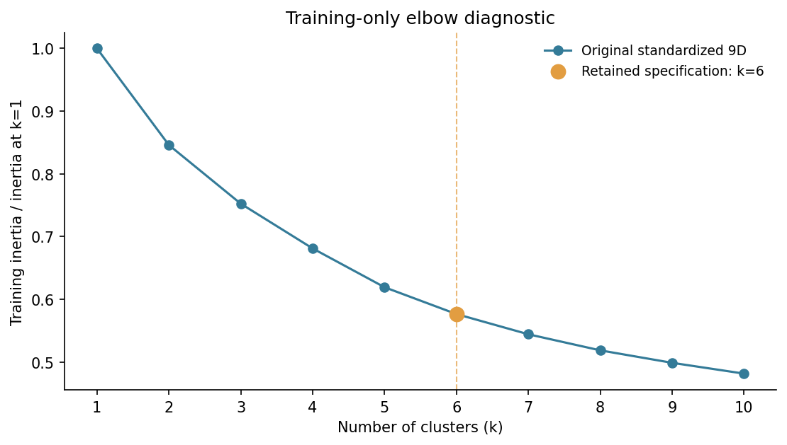

# Spotify Six-Group K-Means

One reproducible specification for the STSCI 5954 playlist project:
**nine original standardized audio features + K-means with six clusters**.

The package contains the supplied clean data, complete source code, processed assignments,
metrics, figures, listening examples, saved delivery model, and English reports.
It does not perform a representation, algorithm, or cluster-count search.

## Start here

- [Full analysis report](reports/analysis_report.md)
- [HTML results page](reports/index.html)
- [Concise workflow summary](reports/workflow_summary.txt)
- [All song assignments](data/processed/songs_with_clusters.csv)
- [Group profiles](output/tables/cluster_profiles.csv)
- [Validation metrics](output/tables/validation_metrics.csv)
- [Test metrics](output/tables/test_metrics.csv)

## Project structure

```text
spotify-kmeans-six-groups/
├── README.md
├── requirements.txt
├── .gitignore
├── run_all.py
├── src/
│   ├── __init__.py
│   ├── clustering.py
│   ├── visualization.py
│   ├── reporting.py
│   └── prediction.py
├── scripts/
│   ├── 01_fit_clusters.py
│   ├── 02_make_figures.py
│   ├── 03_generate_report.py
│   └── 04_predict_new_songs.py
├── data/
│   ├── raw/
│   │   └── tracks_clean.csv
│   ├── processed/
│   │   ├── songs_with_clusters.csv
│   │   └── split_manifest.csv
│   └── examples/
│       └── sample_new_songs.csv
├── docs/
│   └── client_brief.pdf
├── output/
│   ├── summary.json
│   ├── tables/
│   │   ├── elbow_diagnostics.csv
│   │   ├── validation_metrics.csv
│   │   ├── test_metrics.csv
│   │   ├── stability_summary.csv
│   │   ├── stability_repeats.csv
│   │   ├── audio_correlation_train.csv
│   │   ├── cluster_profiles.csv
│   │   ├── representative_songs.csv
│   │   ├── boundary_songs.csv
│   │   └── client_listening_review.csv
│   ├── figures/
│   │   ├── elbow_diagnostic.png
│   │   ├── group_profiles.png
│   │   ├── stability.png
│   │   └── feature_correlation.png
│   ├── models/
│   │   └── playlist_model.joblib
│   └── examples/
│       └── sample_predictions.csv
├── reports/
│   ├── analysis_report.md
│   ├── workflow_summary.txt
│   ├── index.html
│   └── verification.md
└── temp/
    └── .gitkeep
```

## Installation

Use Python 3.12 and install the pinned dependencies. The saved model uses
scikit-learn 1.8.0.

```bash
python -m venv .venv
```

Activate the environment with the appropriate command:

```bash
# macOS / Linux
source .venv/bin/activate

# Windows PowerShell
.venv\Scripts\Activate.ps1
```

```bash
python -m pip install -r requirements.txt
```

## Run everything

From the repository root:

```bash
python run_all.py --include-demo
```

Scripts 01, 02, and 03 run sequentially. The optional demonstration runs script
04 on the six supplied example songs. All existing analysis results needed to
review the project are already included.

Rerunning script 01 overwrites generated results and creates a blank listening
review form. Save completed feedback before refitting.

To redraw figures and regenerate reports without refitting or changing the
listening-review table:

```bash
python run_all.py --skip-fit
```

To run stages separately:

```bash
python scripts/01_fit_clusters.py
python scripts/02_make_figures.py
python scripts/03_generate_report.py
python scripts/04_predict_new_songs.py
```

To predict another compatible song file:

```bash
python scripts/04_predict_new_songs.py --csv path/to/new_songs.csv --output output/new_song_predictions.csv
```

To write an isolated reproduction:

```bash
python run_all.py --project-root temp/reproduction --include-demo
```

The default input is the bundled `tracks_clean.csv`. Use `--csv` to supply another
table satisfying the same clean-input contract.
Default script paths are resolved from the repository location rather than
the caller's working directory. A separate reproduction destination holds
generated artifacts, not a second source-code repository.

## Fixed model

| Setting | Value |
| --- | --- |
| Features | Nine original continuous audio measurements |
| Residual unavailable tempo | Mark nonpositive tempo as missing; use fitted median |
| Scaling | StandardScaler |
| Clustering | KMeans |
| n_clusters | 6 |
| n_init | 20 |
| random_state | 42 |
| Dimensionality reduction | None |
| Model configurations | 1 |

Features, in input order:

```text
danceability, energy, loudness, speechiness, acousticness,
instrumentalness, liveness, valence, tempo
```

## Workflow and code responsibilities

| Stage | Entry script | Reusable implementation |
| --- | --- | --- |
| Read clean input, split, fit, evaluate, and export | scripts/01_fit_clusters.py | src/clustering.py |
| Draw the four figures | scripts/02_make_figures.py | src/visualization.py |
| Generate English Markdown, TXT, and HTML reports | scripts/03_generate_report.py | src/reporting.py |
| Assign new songs using the delivery model | scripts/04_predict_new_songs.py | src/prediction.py |

In `src/clustering.py`, `audio_frame` prepares numeric features,
`preprocessing` creates the imputation/scaling pipeline, `build_pipeline`
fits the fixed K-means specification, `quality` computes the three internal
metrics, and `main` coordinates the workflow and exports.

### Supplied clean input and remaining model preparation

The only analysis source is `data/raw/tracks_clean.csv`: 28,356 rows and
19 columns. It is included byte-for-byte as supplied. Here `data/raw/` means
the immutable input as received; the file is already cleaned and deduplicated.

No deduplication, row averaging, row deletion, or playlist-membership extraction
is performed. The script checks required columns, nonmissing unique track IDs,
and finite numeric audio features. A failed check raises an error instead of
silently changing the input. All supplied rows and their order are retained.

The clean file contains no playlist columns, so the previous membership table
and its export code are omitted. Song and artist metadata still have four
missing values; those songs remain eligible for audio modeling and are excluded
from representative listening examples when the identifying fields are absent.

One track still has `tempo=0`. Its row is kept and that field is marked missing
before model fitting. Median imputation is retained for this remaining
unavailable measurement, using training-only parameters during validation.
StandardScaler is also retained because the supplied nine audio features remain
in different original units. Other valid zeros and extreme values are preserved.

Popularity, song names, and IDs are not clustering inputs. The source filename,
SHA256, row/column counts, and direct-input status are recorded in summary.json.

### Fitting and evaluation order

1. Create the song-level split with seed 42:
   training 17,013; validation 5,671; test 5,672.
2. Fit medians, standardization, and K-means on training songs only.
3. Predict validation groups and evaluate a fixed 2,500-song sample.
4. Refit the same specification on five 80% training subsamples without
   replacement. Compare validation assignments with the reference using ARI.
   Each repeat also changes the initialization seed.
5. Refit on training plus validation, predict the held-out test songs, and
   evaluate a fixed 2,500-song test sample.
6. Fit the delivery pipeline on all 28,356 songs; export groups, profiles,
   examples, and the saved model.

These are repeated fits of one specification. There is no automatic model
selection in this package. Validation describes the fixed model and is not
used to choose a different method or number of clusters.

## Training-only elbow diagnostic



The diagnostic fits K-means for k=1 through 10 on the original standardized
nine-dimensional training features. Each fit uses n_init=20 and seed 42;
the preprocessing parameters are fitted on training songs only.
Inertia is normalized by the value at k=1. The orange marker highlights the
retained k=6 specification rather than an automatically detected knee.

The curve flattens gradually and does not have one uniquely sharp elbow.
The previous nine-scheme comparison combined validation silhouette with
stability and retained original standardized nine-dimensional K-means with
six groups. This plot adds supporting context; it does not independently prove
that six groups are uniquely optimal.

Only k=6 is formally validated, tested, and saved as a delivery model in this
package. Other k values are training-only diagnostic fits, not alternative
selection candidates. There is no automatic cluster-count selection.
The data are in [elbow_diagnostics.csv](output/tables/elbow_diagnostics.csv).

## Results

| Metric | Validation | Test |
| --- | ---: | ---: |
| Silhouette | 0.1573 | 0.1549 |
| Davies-Bouldin | 1.6002 | 1.6117 |
| Calinski-Harabasz | 355.54 | 355.26 |

- Mean subsampling stability ARI: **0.9763**.
- Assignment ARI between the training-only and training-plus-validation
  models on all test songs: **0.9815**.

The three internal metrics use fixed 2,500-song samples.
Stability uses the same full validation set across repeats.
ARI measures consistency, not emotion accuracy. Silhouette around 0.15
indicates considerable overlap between groups.

### Full-data delivery groups

| Group | Tracks | Descriptive audio profile |
| --- | ---: | --- |
| 1 | 4,052 | Low energy and higher acousticness |
| 2 | 3,767 | Stronger spoken-word or rap characteristics |
| 3 | 9,117 | High danceability and higher audio valence |
| 4 | 2,264 | Higher instrumentalness |
| 5 | 1,846 | Higher liveness |
| 6 | 7,310 | Higher energy and faster tempo |

Group numbering is reordered by full-data mean energy and valence.
The model bundle stores the mapping from internal labels to delivery groups.

These are candidate audio groups. Client listening is needed before assigning
mood or activity names. High instrumentalness or liveness alone does not
confirm a calm song, pure instrumental recording, or live performance.

## Included files

| Location | Contents |
| --- | --- |
| data/raw/tracks_clean.csv | Supplied precleaned dataset, unchanged |
| data/processed/songs_with_clusters.csv | All unique tracks, delivery groups, splits, and links |
| data/processed/split_manifest.csv | Track-level partition membership |
| output/summary.json | Input identity and counts, fixed specification, validation, stability, test, mappings, warnings, and runtime versions |
| output/tables/validation_metrics.csv | One row of fixed-model validation metrics |
| output/tables/elbow_diagnostics.csv | Ten training-only inertia records, normalized values, marginal gains, and retained-k marker |
| output/tables/test_metrics.csv | One row of fixed-model test metrics |
| output/tables/stability_summary.csv | Summary of the five subsampling runs |
| output/tables/stability_repeats.csv | Each seed, sample size, ARI, and minimum group share |
| output/tables/audio_correlation_train.csv | Training-feature correlations |
| output/tables/cluster_profiles.csv | Full-data group sizes, shares, feature means, and medians |
| output/tables/representative_songs.csv | Up to ten near-center songs per group with artist diversity |
| output/tables/boundary_songs.csv | Up to three geometric boundary examples per group |
| output/tables/client_listening_review.csv | Blank review form for client feedback |
| output/models/playlist_model.joblib | Delivery pipeline, feature order, specification, and label mapping |
| data/examples/sample_new_songs.csv | Six demonstration inputs from the source catalog |
| output/examples/sample_predictions.csv | Predictions for those demonstration songs |
| output/figures/ | Training elbow curve, group profiles, stability, and feature correlations |
| reports/ | English report, summary, HTML page, and verification |
| docs/client_brief.pdf | Supplied project brief |

New-song prediction requires the nine feature columns and uses saved
preprocessing. It does not read an audio file or collect online features.
The supplied example is a functional check, not an independent test.

## Scope and GitHub upload

Code, documentation, and filenames are in English. Original song titles,
artist names, and playlist names retain their source language.

The input file is now tracks_clean.csv; the six-group model specification and
evaluation workflow are retained. See [verification](reports/verification.md)
for the reproduction checks. This package contains only that configuration,
its metrics, and its delivery artifacts.

Extract the ZIP and upload the contents of `spotify-kmeans-six-groups/`
so that README.md is at the GitHub repository root. Generated analysis files
are intentionally included; temporary work, caches, and virtual environments
are ignored. No repository is published automatically.

