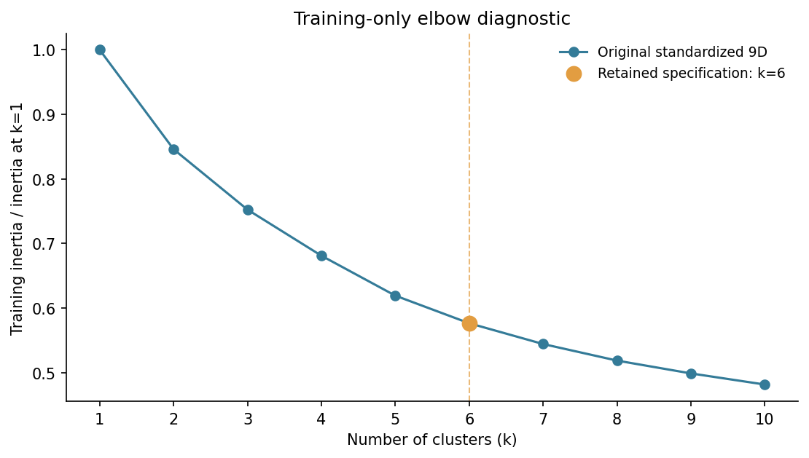
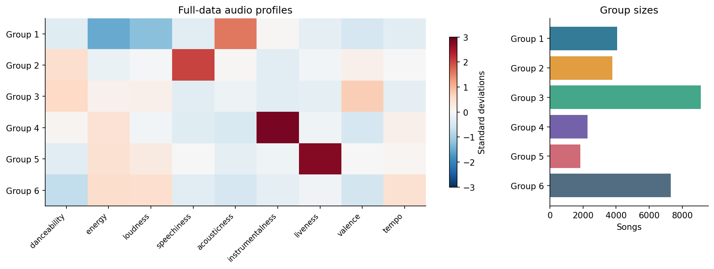
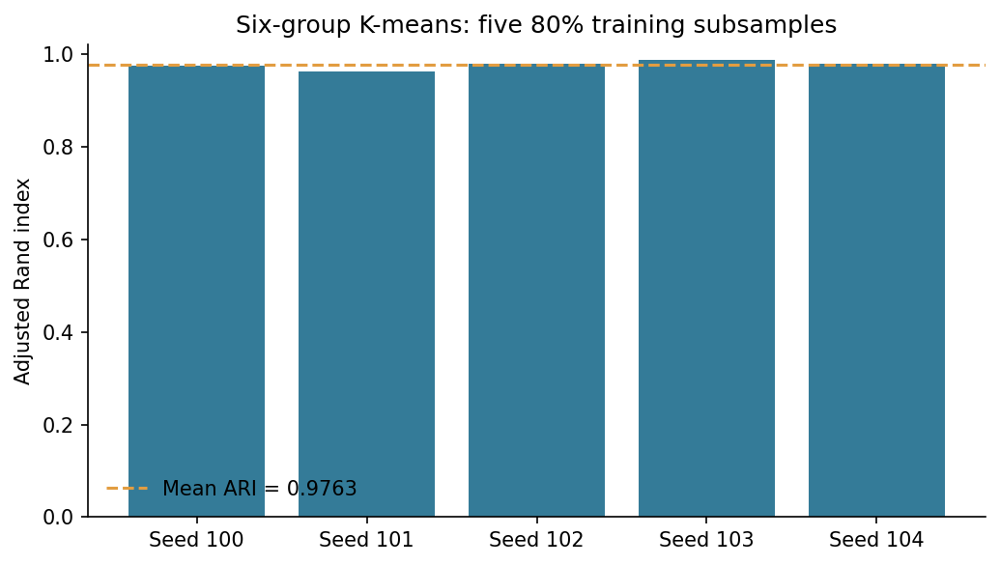
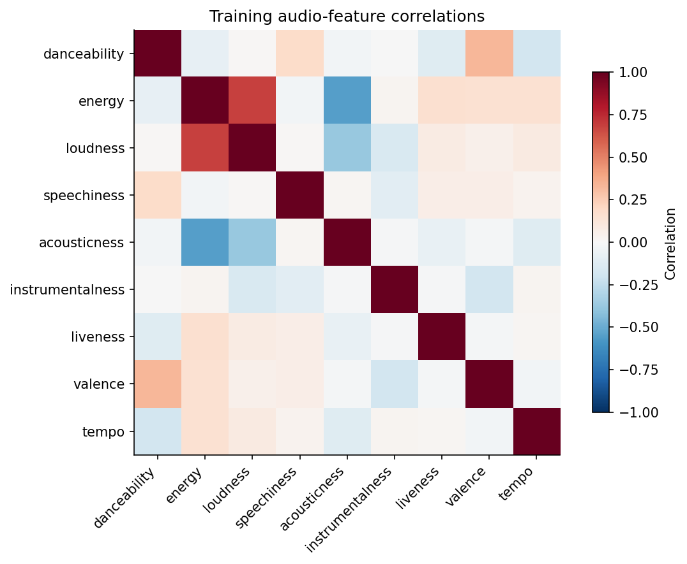

# Six-Group K-Means: Analysis Report

## Fixed specification

This package implements one model specification: median imputation, standardization
of nine original continuous audio features, and K-means with k=6, n_init=20,
and random_state=42. The specification was fixed before running this package.
There is no representation search, algorithm search, or cluster-count selection.
A separate training-only elbow diagnostic supplies context without changing k=6.

The model is fitted at different stages for validation, test evaluation, stability
checks, and full-data delivery. Those repeated fits use the same specification;
they are not alternative candidate configurations.

## Training-only elbow diagnostic

The curve uses original standardized nine-dimensional training features only.
For k=1 through 10, K-means uses n_init=20 and seed 42. The vertical axis is
inertia divided by its value at k=1. The orange marker identifies the retained
six-group specification; it is not an automatically detected knee.

The curve gradually flattens and has no uniquely sharp elbow. It provides
supporting context, while the earlier nine-scheme comparison used validation
silhouette and stability to retain original standardized features with k=6.
This single-model package does not repeat that candidate selection. Other k
values appear only in this diagnostic and receive no validation or test scores.
The table is [elbow_diagnostics.csv](../output/tables/elbow_diagnostics.csv).

## Data and preprocessing

The supplied tracks_clean.csv has 28,356 rows and
19 columns, with 28,356 unique track IDs.
It is consumed directly in the supplied row order. No deduplication, averaging,
or row filtering is performed. Input checks verify required fields, unique
nonmissing IDs, and finite numeric audio values, raising an error if the input
does not meet the clean-table contract.

The source is already deduplicated but is not standardized. It has no playlist
columns, so no original playlist-membership table is reconstructed or exported.
The exact supplied file is stored unchanged in data/raw/tracks_clean.csv;
the raw directory denotes the input as supplied, not an uncleaned source.

The nine features are danceability, energy, loudness, speechiness, acousticness, instrumentalness, liveness, valence, tempo.
Popularity, IDs, and identifying metadata do not enter clustering.
Four tracks with missing metadata remain eligible for audio modeling.
The one nonpositive tempo value is treated as missing. Other valid zeros and
extreme but valid measurements are retained. The input has no missing audio
measurements apart from the nonpositive tempo that is marked unavailable.
Malformed or nonfinite audio input is rejected rather than silently cleaned.

SimpleImputer uses fitted feature medians; StandardScaler uses fitted feature
means and standard deviations. The feature space is not reduced.

## Data partitions and fitting order

| Partition | Tracks | Role |
| --- | ---: | --- |
| Training | 17,013 | Fit preprocessing and the reference K-means model |
| Validation | 5,671 | Describe fixed-model grouping quality |
| Test | 5,672 | Evaluate the fixed specification after refitting |

The seed is 42. The two-stage split reproduces the earlier song-level split.
Each track_id belongs to exactly one partition.

1. Fit medians, scaler, and K-means on training songs.
2. Predict validation assignments and calculate validation metrics.
3. Check stability using five 80% training subsamples.
4. Refit preprocessing and K-means on training plus validation.
5. Predict the held-out test songs and calculate test metrics.
6. Fit the delivery model on all tracks and export assignments and profiles.

Validation does not select among candidate specifications in this package.
The test data do not participate in the earlier fitting stages.
Full-data delivery outputs are not independent test evidence.
Splitting by track_id does not guarantee separation of recording families,
duplicate releases, alternate versions, or artists.

## Grouping quality

| Metric | Validation | Test |
| --- | --- | --- |
| Silhouette (higher is better) | 0.1573 | 0.1549 |
| Davies-Bouldin (lower is better) | 1.6002 | 1.6117 |
| Calinski-Harabasz (higher is better) | 355.5371 | 355.2559 |

Each metric uses a fixed random sample of 2,500 songs from its partition and the
appropriate fitted standardized nine-dimensional feature space.
The assignment ARI between the training-only model and the model refitted on
training plus validation is 0.9815, calculated
on all 5,672 test songs.

Silhouette around 0.15 indicates substantial overlap. ARI describes agreement
between two groupings, not emotion-classification accuracy.

## Stability

Each repeat samples 80% of the training songs without replacement, refits
imputation, scaling, and K-means, and predicts the same full validation set.
ARI compares each repeat with the reference training model.
The initialization seed also changes across repeats.

| Seed | Training songs | ARI |
| --- | --- | --- |
| 100 | 13610 | 0.9742 |
| 101 | 13610 | 0.9620 |
| 102 | 13610 | 0.9786 |
| 103 | 13610 | 0.9882 |
| 104 | 13610 | 0.9785 |

Mean stability ARI is 0.9763.
This is subsampling rather than bootstrap sampling.
A stable result does not prove that groups match listener moods or activities.

## Full-data delivery groups

| Group | Tracks | Share | Audio description |
| --- | --- | --- | --- |
| 1 | 4,052 | 14.3% | Low energy and higher acousticness |
| 2 | 3,767 | 13.3% | Stronger spoken-word or rap characteristics |
| 3 | 9,117 | 32.2% | High danceability and higher audio valence |
| 4 | 2,264 | 8.0% | Higher instrumentalness |
| 5 | 1,846 | 6.5% | Higher liveness |
| 6 | 7,310 | 25.8% | Higher energy and faster tempo |

Delivery group numbers are ordered by mean energy, then valence, after the
full-data fit. They differ from raw internal estimator labels.
Group profiles include each feature's mean and median.

Higher instrumentalness does not prove calmness or a pure instrumental recording.
Higher liveness does not confirm a live recording. Audio valence is a measured
feature, not a human-verified mood target. Client listening is needed before
assigning final mood or activity names.

## Listening examples and prediction

The representative-song table contains up to ten close-to-center songs per
group, with different artists where possible. The boundary table contains up to
three songs per group with small relative gaps between the nearest two centers.
These are geometric examples, not confidence-calibrated emotion predictions.

The listening-review table is blank and awaits client input. No listening
feedback is claimed. Track links are provided without checking regional
playability.

The prediction script requires all nine feature columns and reuses the saved
delivery pipeline. It fills individual missing values using saved medians,
rejects rows with no usable audio measurements, and checks bounded features.
The supplied six-song example is drawn from the existing catalog; it is a
functional example rather than a new independent test.

## Figures

## Reproduction and files

See [README.md](../README.md) for the directory tree, numbered scripts,
dependencies, reproduction commands, and file descriptions.

The supplied clean CSV, client brief, processed data, model, metrics, profiles, example
songs, and figures are included. Song and playlist names retain their original
source language; documentation, comments, and filenames are in English.

## Sources

- [Supplied clean CSV](../data/raw/tracks_clean.csv).
- [Supplied client brief](../docs/client_brief.pdf).
- https://scikit-learn.org/stable/modules/clustering.html#k-means
- https://scikit-learn.org/stable/common_pitfalls.html

The client brief requests natural song groupings and listening examples.
The preprocessing choices, split proportions, and fixed model settings are
project decisions, not instructions quoted from the brief.
