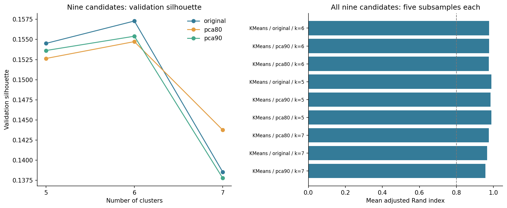
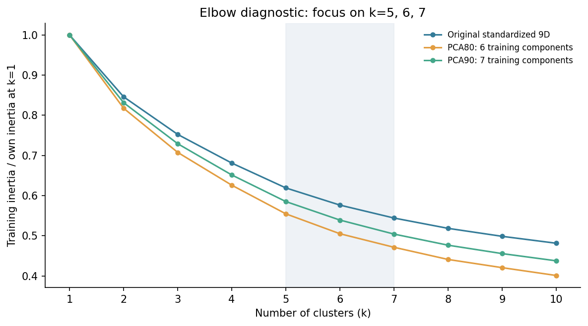
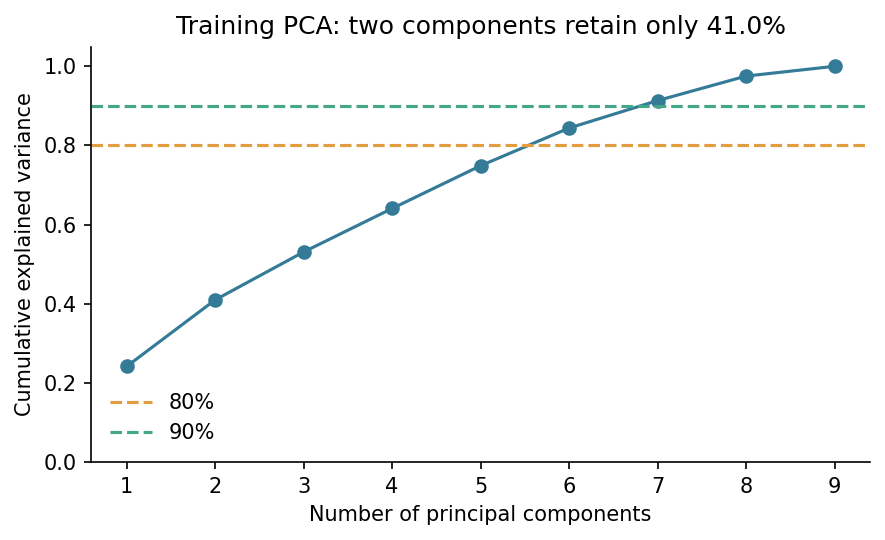
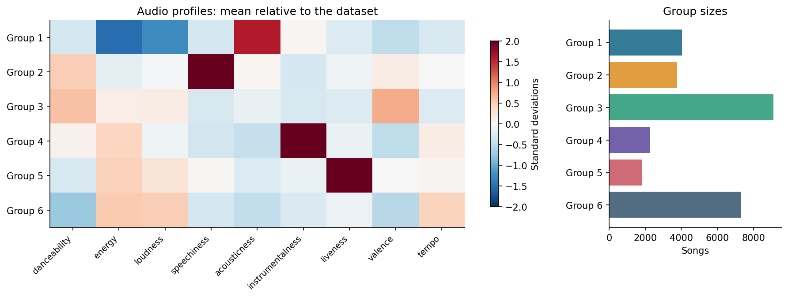

# Spotify K-Means: Nine Comparisons

A focused comparison for the STSCI 5954 playlist project:

- Three representations: original standardized nine features, PCA80, PCA90.
- One algorithm: K-means.
- Three cluster counts: k=5, 6, 7.
- Exactly nine configurations enter validation scoring and final selection.

**Selected configuration: Original standardized 9D + K-means,
k=6.** Validation silhouette:
0.1573; mean stability ARI:
0.9763; test silhouette:
0.1549.

All source data, code, results, figures, reports, and the selected delivery model
are included. Documentation, comments, and filenames are in English.

## Nine-scheme comparison

All rows below use the same 2,500-song validation sample and the same original
standardized nine-dimensional evaluation space, even when the model is fitted
in a PCA representation. This keeps geometric scores comparable.

| Representation | k | Dimensions | Silhouette ↑ | DB ↓ | CH ↑ | Mean stability ARI ↑ | Status |
| --- | --- | --- | --- | --- | --- | --- | --- |
| Original standardized 9D | 5 | 9 | 0.1545 | 1.7089 | 374.55 | 0.9888 | Eligible |
| Original standardized 9D | 6 | 9 | 0.1573 | 1.6002 | 355.54 | 0.9763 | Selected |
| Original standardized 9D | 7 | 9 | 0.1385 | 1.6519 | 334.45 | 0.9659 | Eligible |
| PCA80 | 5 | 6 | 0.1526 | 1.7083 | 373.72 | 0.9885 | Eligible |
| PCA80 | 6 | 6 | 0.1547 | 1.6035 | 353.91 | 0.9750 | Eligible |
| PCA80 | 7 | 6 | 0.1438 | 1.5778 | 334.00 | 0.9750 | Eligible |
| PCA90 | 5 | 7 | 0.1536 | 1.7102 | 373.97 | 0.9840 | Eligible |
| PCA90 | 6 | 7 | 0.1554 | 1.6059 | 354.20 | 0.9757 | Eligible |
| PCA90 | 7 | 7 | 0.1378 | 1.6538 | 333.16 | 0.9571 | Eligible |

Silhouette is the primary ranking metric after the group-size and stability
requirements. DB and CH are reported as supporting diagnostics. They need not
rank candidates in the same order.

All nine candidates have at least 1% membership in each training and validation
group and mean stability ARI at least 0.8. The original nine-dimensional k=6
configuration has the highest validation silhouette. The k=5 candidates are
slightly more stable, but the k=6 choice has better silhouette while remaining
stable. At k=6, neither PCA option improves on the original representation.
This does not establish that PCA is always worse or that the small differences
are statistically significant.



Detailed numerical files:
[validation_grid.csv](output/tables/validation_grid.csv),
[model_comparison.csv](output/tables/model_comparison.csv), and
[stability_repeats.csv](output/tables/stability_repeats.csv).
The comparison table contains all nine configurations; the repeat table contains
five runs for each configuration, for 45 stability records.

## Elbow diagnostic and candidate range

The training-only elbow plot gives context for the focused k=5, 6, 7 comparison.
The curves flatten gradually and do not have a sharp unique knee. The compact
range is a project decision informed by that diagnostic, the earlier exploration,
and the project discussion about at least five groups. It is not a mathematically
unique range returned by an automated elbow detector.



For a useful reference curve, the elbow diagnostic evaluates training inertia
for k=1 through 10 in each representation. These are diagnostic fits only.
They are separate from the nine formally compared configurations: k outside
5, 6, 7 receives no validation or test score and cannot be selected.

Inertia is measured in each representation's own fitted space. The plot divides
each curve by its own k=1 inertia so its flattening is easier to inspect;
curve heights do not show that one representation has better separation than
another. Validation metrics use the shared nine-dimensional space instead.

The table [elbow_diagnostics.csv](output/tables/elbow_diagnostics.csv) includes
30 training-only diagnostic records and explicitly flags the nine comparison
candidates. Candidate fits are reused when generating the diagnostic.

This is a focused follow-up to an earlier analysis of the same data. It does
not retrospectively claim that this narrower range was the original search
plan, or that the elbow plot independently proves k=6 is optimal.

## PCA results

PCA is fitted after median imputation and standardization, using training data
only during comparison.

| Representation | Dimensions | Retained training variance |
| --- | --- | --- |
| Original standardized 9D | 9 | 100.00% |
| PCA80 | 6 | 84.39% |
| PCA90 | 7 | 91.34% |

| PC | Individual variance | Cumulative variance |
| --- | --- | --- |
| 1 | 24.15% | 24.15% |
| 2 | 16.82% | 40.97% |
| 3 | 12.11% | 53.08% |
| 4 | 10.99% | 64.07% |
| 5 | 10.80% | 74.88% |
| 6 | 9.52% | 84.39% |
| 7 | 6.94% | 91.34% |
| 8 | 6.19% | 97.53% |
| 9 | 2.47% | 100.00% |

PCA80 means retaining at least 80% of training variance; it requires six principal
components here and retains 84.39%. PCA90 requires seven components and retains
91.34%. The first two components explain only 40.97%, so two dimensions are not
used to fit the compared clustering models.

The number of principal components and the number of clusters are different:
six components do not imply six groups. The nine comparisons vary k independently.



The full loadings are in [pca_axes.csv](output/tables/pca_axes.csv).
A loading's sign is arbitrary; inspect large absolute loadings to see which
original features contribute to each axis. PCA maximizes retained variance,
rather than directly maximizing cluster separation.

The [two-dimensional group projection](output/figures/pca_group_projection.png)
is descriptive: it fits a separate two-component PCA to the standardized
full-data delivery representation and plots 4,000 songs. Its axes are not the
training PCA used for the explained-variance table or model selection.

## Data preparation and evaluation

The supplied tracks_clean.csv contains 28,356 tracks and 19 columns.
It is read directly without repeating deduplication or raw-data cleaning.
Track IDs are checked for uniqueness; all input rows are retained.
Playlist membership fields are absent, so no playlist-membership export is made.
Different track IDs remain even when title and artist match.

The nine continuous input features are:

```text
danceability, energy, loudness, speechiness, acousticness,
instrumentalness, liveness, valence, tempo
```

Nonpositive tempo and unusable numeric values are treated as missing.
Other valid zeros and extreme values remain. SimpleImputer uses fitted medians;
StandardScaler uses fitted means and standard deviations.
Four tracks with missing identifying metadata remain in audio modeling but are
excluded from representative examples where their name or artist is missing.
Popularity, playlist genre, and identifying metadata are not clustering inputs.

| Partition | Tracks | Purpose |
| --- | ---: | --- |
| Training | 17,013 | Fit preprocessing, PCA, and candidate models |
| Validation | 5,671 | Compare the nine candidates and their stability |
| Test | 5,672 | Reproduce the frozen selected-model evaluation |

Seed 42 reproduces the original two-stage split. No track_id crosses partitions.
Recording-family and artist overlap may remain across the track-ID split.

### Selection and stability

All candidate fits use KMeans(n_init=20, random_state=42).
Each representation fits its own training preprocessing. Candidate eligibility
requires every group to contain at least 1% of training and validation songs.
For each of the nine configurations, five runs sample 80% of training songs
without replacement, refit preprocessing and K-means, and predict the same full
validation set. Seeds 100 through 104 vary both subsampling and initialization.

Mean ARI must be at least 0.8. Among candidates passing the size and stability
criteria, choose the highest validation silhouette. These cutoffs are project
rules, not general statistical laws. No true mood labels are used.

### Test and full-data delivery

After selection, refit preprocessing and clustering on training plus validation.
Compute silhouette, DB, and CH on a fixed 2,500-song test sample, and assignment
ARI on all 5,672 test songs. Then fit the delivery model on all 28,356 songs.

| Test metric | Value |
| --- | --- |
| Silhouette | 0.1549 |
| Davies-Bouldin | 1.6117 |
| Calinski-Harabasz | 355.26 |
| Assignment ARI: training-only vs refitted | 0.9815 |

This rerun reproduces the prior held-out evaluation on the same split; it is
not a newly collected independent test. The code preserves the separation of
training, validation, test evaluation, and full-data delivery.
High ARI measures reproducibility. Silhouette around 0.15 still indicates
overlapping groups. Neither is mood-classification accuracy.

### Full-data group profiles

| Group | Tracks | Share | Descriptive audio profile |
| --- | --- | --- | --- |
| 1 | 4,052 | 14.3% | Low energy and higher acousticness |
| 2 | 3,767 | 13.3% | Stronger spoken-word or rap characteristics |
| 3 | 9,117 | 32.2% | High danceability and higher audio valence |
| 4 | 2,264 | 8.0% | Higher instrumentalness |
| 5 | 1,846 | 6.5% | Higher liveness |
| 6 | 7,310 | 25.8% | Higher energy and faster tempo |

Group numbering is ordered by full-data mean energy, then valence. The saved
model includes the mapping from raw estimator labels to delivery groups.
Client listening is still required before naming groups for moods or activities.



## Project structure

```text
spotify-kmeans-nine-comparisons/
├── README.md
├── requirements.txt
├── .gitignore
├── run_all.py
├── src/
│   ├── __init__.py
│   ├── clustering.py
│   ├── visualization.py
│   ├── reporting.py
│   └── prediction.py
├── scripts/
│   ├── 01_fit_clusters.py
│   ├── 02_make_figures.py
│   ├── 03_generate_report.py
│   └── 04_predict_new_songs.py
├── data/
│   ├── raw/
│   │   └── tracks_clean.csv
│   ├── processed/
│   │   ├── songs_with_clusters.csv
│   │   └── split_manifest.csv
│   └── examples/
│       └── sample_new_songs.csv
├── docs/
│   └── client_brief.pdf
├── output/
│   ├── summary.json
│   ├── tables/
│   │   ├── validation_grid.csv
│   │   ├── model_comparison.csv
│   │   ├── stability_repeats.csv
│   │   ├── elbow_diagnostics.csv
│   │   ├── representation_summary.csv
│   │   ├── pca_variance.csv
│   │   ├── pca_axes.csv
│   │   ├── audio_correlation_train.csv
│   │   ├── cluster_profiles.csv
│   │   ├── representative_songs.csv
│   │   ├── boundary_songs.csv
│   │   └── client_listening_review.csv
│   ├── figures/
│   │   ├── elbow_diagnostic.png
│   │   ├── model_comparison.png
│   │   ├── pca_variance.png
│   │   ├── pca_group_projection.png
│   │   └── group_profiles.png
│   ├── models/
│   │   └── playlist_model.joblib
│   └── examples/
│       └── sample_predictions.csv
├── reports/
│   ├── analysis_report.md
│   ├── workflow_summary.txt
│   ├── index.html
│   └── verification.md
└── temp/
    └── .gitkeep
```

## Code structure

| Stage | Script | Reusable code and responsibility |
| --- | --- | --- |
| 1 | scripts/01_fit_clusters.py | src/clustering.py: load cleaned data/split, training PCA and elbow diagnostics, nine-candidate comparison, 45 stability repeats, final evaluation and delivery |
| 2 | scripts/02_make_figures.py | src/visualization.py: render five figures from saved outputs |
| 3 | scripts/03_generate_report.py | src/reporting.py: generate this README, Markdown report, English summary, and HTML results page |
| 4 | scripts/04_predict_new_songs.py | src/prediction.py: assign compatible song rows with the selected delivery model |
| All | run_all.py | Execute stages 1–3 in order; optionally run the stage-4 demonstration |

In src/clustering.py, audio_frame prepares numeric features; preprocessing
builds imputation, scaling, and optional PCA; estimator creates K-means only
for candidate k values 5, 6, 7; quality computes comparable metrics;
build_pipeline refits one configuration; main coordinates diagnostics,
selection, evaluation, and output exports.

Only the selected full-data model is saved as a reusable model bundle.
All nine candidate results and stability repeats are saved as tables.
The code can reproduce candidate models from the included data and settings.

## Reproduction

Use Python 3.12 and the pinned requirements. The included model was fitted using
scikit-learn 1.8.0.

```bash
python -m venv .venv
```

Activate with the appropriate command:

```bash
# macOS / Linux
source .venv/bin/activate

# Windows PowerShell
.venv\Scripts\Activate.ps1
```

```bash
python -m pip install -r requirements.txt
python run_all.py --include-demo
```

The full run recomputes the nine comparisons, training elbow diagnostics,
stability, selected-model test metrics, delivery outputs, figures, and English
documentation. Script 01 creates a fresh blank listening-review form, so
preserve completed client feedback before refitting.

To regenerate figures and documentation from included results:

```bash
python run_all.py --skip-fit
```

This leaves the model, comparison tables, assignments, and listening-review
table untouched.

To run individual stages:

```bash
python scripts/01_fit_clusters.py
python scripts/02_make_figures.py
python scripts/03_generate_report.py
python scripts/04_predict_new_songs.py
```

To predict another song file:

```bash
python scripts/04_predict_new_songs.py --csv path/to/new_songs.csv --output output/new_song_predictions.csv
```

To write a separate reproduction:

```bash
python run_all.py --project-root temp/reproduction --include-demo
```

Default inputs resolve from the source repository, regardless of the shell's
working directory. Use --csv to select another compatible source dataset.

## Output file guide

| File | Contents |
| --- | --- |
| output/tables/validation_grid.csv | Exactly nine candidate rows: representation, k, dimensions, validation metrics, group sizes, warnings |
| output/tables/model_comparison.csv | Those nine candidates with stability summaries and the selected flag |
| output/tables/stability_repeats.csv | All 45 individual subsampling runs |
| output/tables/elbow_diagnostics.csv | Thirty training-only inertia records, normalized curves, gains, candidate flags |
| output/tables/representation_summary.csv | Actual fitted dimensions and retained training variance |
| output/tables/pca_variance.csv | Individual and cumulative training variance for all PCs |
| output/tables/pca_axes.csv | Training PCA loadings |
| output/tables/audio_correlation_train.csv | Training-feature correlations |
| output/tables/cluster_profiles.csv | Selected delivery-model group sizes, means, and medians |
| output/tables/representative_songs.csv | Up to ten close-to-center songs per group, with artist diversity |
| output/tables/boundary_songs.csv | Up to three boundary examples per group |
| output/tables/client_listening_review.csv | Blank client naming and fit-review template |
| data/processed/songs_with_clusters.csv | All unique tracks, selected delivery groups, splits, and links |
| data/processed/split_manifest.csv | Track-level train/validation/test membership |
| output/summary.json | Counts, nine-candidate scope, elbow scope, chosen configuration, test results, mappings, versions |
| output/models/playlist_model.joblib | Selected full-data pipeline, feature order, specification, label mapping |
| output/examples/sample_predictions.csv | Predictions for the supplied six-song demonstration |
| reports/ | English report, workflow summary, HTML page, and verification |

The example songs are sampled from the source catalog. Their predictions verify
functionality, not independent performance. New-song input needs all nine audio
feature columns; individual missing measurements use saved medians. Completely
unusable rows and invalid bounded values are rejected. No audio-file feature
extraction or external data collection is implemented.

## Documentation, sources, and GitHub upload

See [analysis report](reports/analysis_report.md),
[workflow summary](reports/workflow_summary.txt),
[HTML results page](reports/index.html), and
[verification](reports/verification.md).

The [client brief](docs/client_brief.pdf) and unmodified
[cleaned CSV](data/raw/tracks_clean.csv) are included.
The brief asks for natural audio-based groupings and listening examples; exact
preprocessing, split ratios, algorithm settings, and thresholds are project
choices. No complete course grading rubric is assumed.

Song titles, artist names, and playlist names preserve their original source
language. English documentation does not alter source metadata.

Extract the ZIP and upload the contents of spotify-kmeans-nine-comparisons/
with README.md at the repository root. Data and analysis outputs are
intentionally included. Temporary runs, caches, and virtual environments are
ignored. No repository is automatically published.
