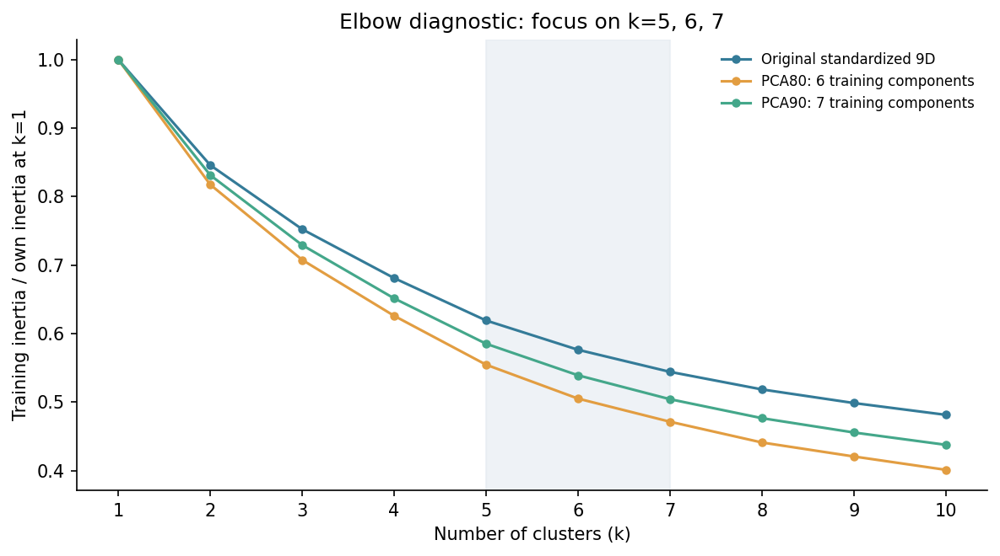
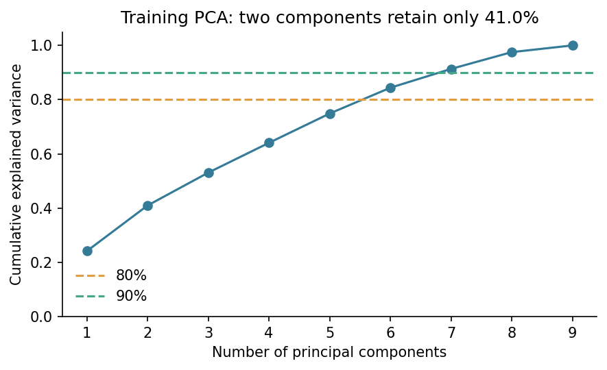
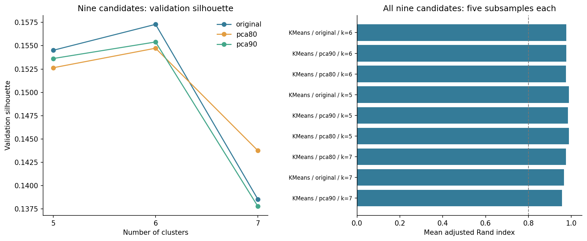
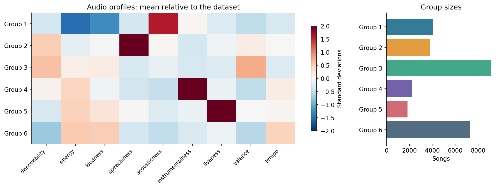
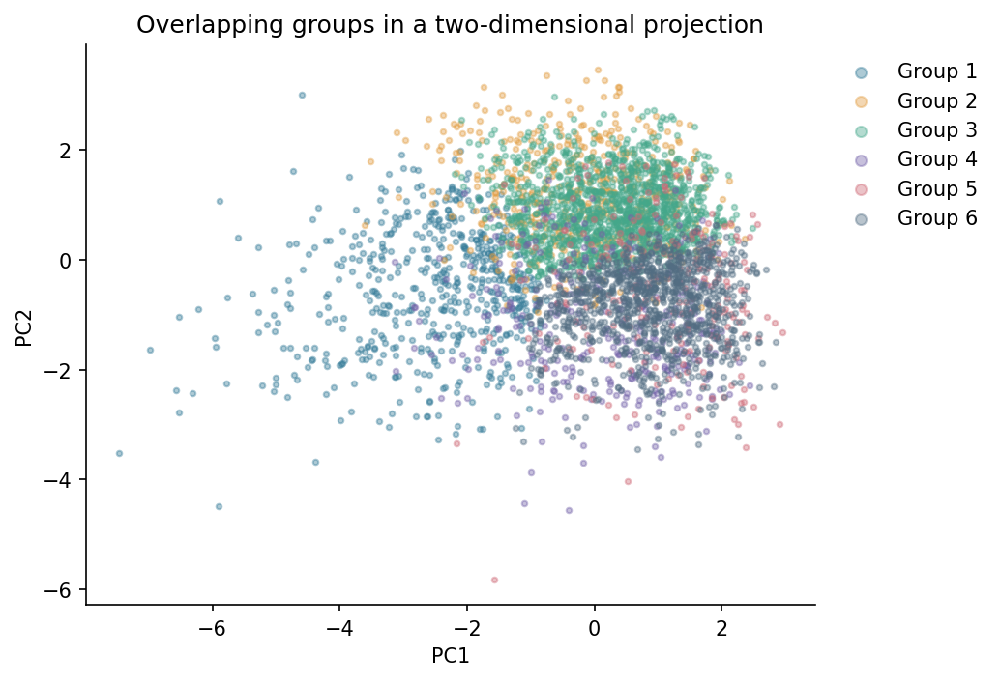

# Analysis Report: Nine K-Means Comparisons

## Scope and selection

The formal comparison consists of three representations and k=5, 6, 7:
nine K-means configurations. Training-only elbow curves provide contextual
diagnostics. They do not automatically or uniquely identify the candidate range.
This is a focused follow-up on the same previously analyzed data.

| Representation | k | Dimensions | Silhouette ↑ | DB ↓ | CH ↑ | Mean stability ARI ↑ | Status |
| --- | --- | --- | --- | --- | --- | --- | --- |
| Original standardized 9D | 5 | 9 | 0.1545 | 1.7089 | 374.55 | 0.9888 | Eligible |
| Original standardized 9D | 6 | 9 | 0.1573 | 1.6002 | 355.54 | 0.9763 | Selected |
| Original standardized 9D | 7 | 9 | 0.1385 | 1.6519 | 334.45 | 0.9659 | Eligible |
| PCA80 | 5 | 6 | 0.1526 | 1.7083 | 373.72 | 0.9885 | Eligible |
| PCA80 | 6 | 6 | 0.1547 | 1.6035 | 353.91 | 0.9750 | Eligible |
| PCA80 | 7 | 6 | 0.1438 | 1.5778 | 334.00 | 0.9750 | Eligible |
| PCA90 | 5 | 7 | 0.1536 | 1.7102 | 373.97 | 0.9840 | Eligible |
| PCA90 | 6 | 7 | 0.1554 | 1.6059 | 354.20 | 0.9757 | Eligible |
| PCA90 | 7 | 7 | 0.1378 | 1.6538 | 333.16 | 0.9571 | Eligible |

The selected candidate is Original standardized 9D, k=6.
The selection rule is highest validation silhouette after at least 1% group
membership in training and validation and mean subsampling ARI at least 0.8.
All nine pass those requirements. The five-group models are slightly more
stable, but six groups improve silhouette while remaining stable. Supporting
DB and CH metrics have different preferences.

## Elbow interpretation

Training inertia decreases gradually rather than showing one uniquely sharp
knee. The project uses the compact 5–7 range as a practical focused comparison.
Thirty diagnostic training fits span k=1–10 across the three representations;
only the flagged nine k=5,6,7 configurations enter validation and selection.
Normalized curve heights are not cross-representation quality scores.

## PCA

| Representation | Dimensions | Retained training variance |
| --- | --- | --- |
| Original standardized 9D | 9 | 100.00% |
| PCA80 | 6 | 84.39% |
| PCA90 | 7 | 91.34% |

| PC | Individual variance | Cumulative variance |
| --- | --- | --- |
| 1 | 24.15% | 24.15% |
| 2 | 16.82% | 40.97% |
| 3 | 12.11% | 53.08% |
| 4 | 10.99% | 64.07% |
| 5 | 10.80% | 74.88% |
| 6 | 9.52% | 84.39% |
| 7 | 6.94% | 91.34% |
| 8 | 6.19% | 97.53% |
| 9 | 2.47% | 100.00% |

Six principal components retain 84.39% of training variance; seven retain 91.34%.
The first two explain only 40.97%. Component count and cluster count are
independent design choices. PCA maximizes explained variance, not silhouette.

At k=6, PCA does not improve validation silhouette over original standardized
features in this dataset. The score differences are small and are not supported
by a formal significance test. Loadings are provided in
[pca_axes.csv](../output/tables/pca_axes.csv).

## Data, split, and evaluation

The supplied tracks_clean.csv contains 28,356 tracks and 19 columns.
All rows are used directly, without repeated deduplication. Playlist fields
are not supplied and no playlist-membership file is generated. Different IDs
with the same title and artist remain. The nine features are danceability, energy, loudness, speechiness, acousticness, instrumentalness, liveness, valence, tempo.
One nonpositive tempo becomes missing, other valid zeros remain, and four
metadata-missing tracks remain available for audio modeling.

Training, validation, and test sizes are 17,013, 5,671, and 5,672, using seed 42.
Imputation, scaling, PCA, and candidate clustering fit training songs only.
All validation metrics use the same 2,500 validation songs in the original
standardized nine-dimensional space.

Each candidate receives five 80% training subsamples without replacement.
Every repeat refits its own preprocessing and model, with seeds 100–104.
ARI compares assignments on the same full validation set with the reference
training model. These 45 runs include variation in both samples and
initialization. This is subsampling, not bootstrap sampling.

After freezing the chosen configuration, the model is refitted on training plus
validation, evaluated on the test set, and finally fitted on all songs for delivery.

| Test metric | Value |
| --- | --- |
| Silhouette | 0.1549 |
| Davies-Bouldin | 1.6117 |
| Calinski-Harabasz | 355.26 |
| Assignment ARI: training-only vs refitted | 0.9815 |

The first three test metrics use 2,500 test songs; assignment ARI uses all 5,672.
This reproduces the earlier held-out evaluation rather than introducing a new
independent test sample. High stability does not establish mood accuracy,
and silhouette around 0.15 shows group overlap.

## Delivery groups and listening

| Group | Tracks | Share | Descriptive audio profile |
| --- | --- | --- | --- |
| 1 | 4,052 | 14.3% | Low energy and higher acousticness |
| 2 | 3,767 | 13.3% | Stronger spoken-word or rap characteristics |
| 3 | 9,117 | 32.2% | High danceability and higher audio valence |
| 4 | 2,264 | 8.0% | Higher instrumentalness |
| 5 | 1,846 | 6.5% | Higher liveness |
| 6 | 7,310 | 25.8% | Higher energy and faster tempo |

Representative songs are close to their group's center; boundary examples have
small relative gaps between their nearest two centers. They are geometric
examples, not calibrated emotion-confidence scores. Client review fields
remain blank. High instrumentalness or liveness alone does not prove calmness,
a pure instrumental track, or a live recording.

The two-dimensional projection is a separate full-data descriptive PCA fit,
not the training PCA in the variance table. It displays 4,000 sampled songs
and was not used to fit the selected clusters.

## Reproduction and limitations

Read [README.md](../README.md) for code structure, the complete directory tree,
commands, and artifact descriptions. The selected full-data model supports
new rows with the same nine measurements. The example input is sampled from
the existing catalog and is not a new test set.

No true mood or activity labels, completed listening feedback, online feature
collection, or supervised classification are claimed. Duplicate releases and
artist overlap may cross the song-ID split.

Sources: [cleaned CSV](../data/raw/tracks_clean.csv),
[client brief](../docs/client_brief.pdf), and the included executable source.
